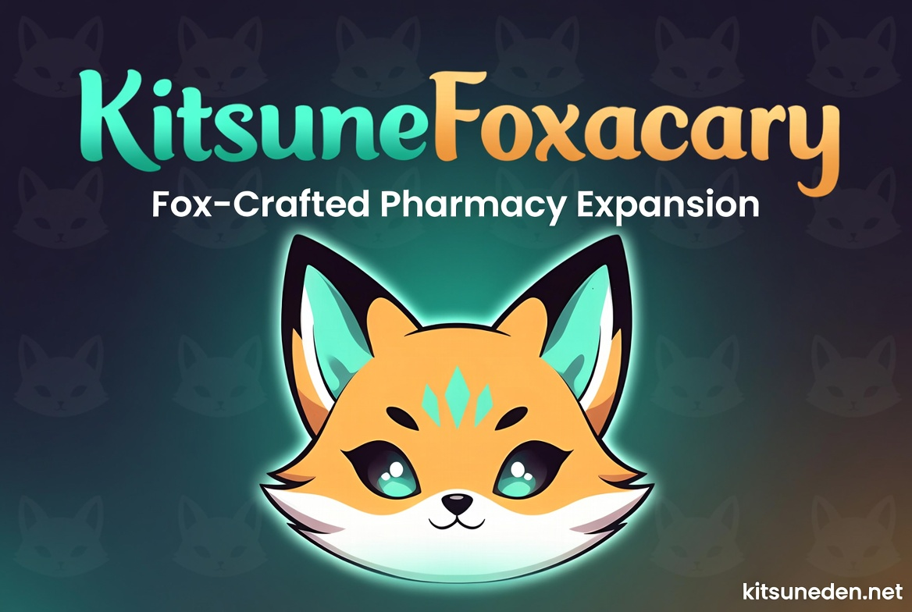

# KitsuneFoxacary

🦊 **Part of the [Kitsune Systems Collection](https://github.com/Kitsune-Den)** ~
[KitsunePvPExtended](https://github.com/Kitsune-Den/KitsunePvPExtended) ·
[KitsuneTrapXP](https://github.com/Kitsune-Den/KitsuneTrapXP) ·
[KitsuneZombieReach](https://github.com/Kitsune-Den/KitsuneZombieReach) ·
[KitsuneKitchen7D](https://github.com/Kitsune-Den/KitsuneKitchen7D) ·
[KitsuneFuelSaver](https://github.com/Kitsune-Den/KitsuneFuelSaver)

Fox-crafted pharmacy expansion for 7 Days to Die. Think KitsuneKitchen, but for the topical, injected, and bandaged side of survival.

## Why

Vanilla 7D2D has some real gaps in the medical tree:

- You can't cure a sprain without dumping a point into Physician. For Agility archetypes or pure loot-runners, that perk isn't a priority, so they get to walk slowly for ten minutes instead.
- Blood bags pile up as loot, and vanilla only puts them into Fort Bites and First Aid Kits. Most end up sold to traders.
- Queen Bees are worse off. The item exists, but nothing in vanilla drops it and no recipe uses it.
- Testosterone extract is harvested constantly and used in only two recipes.

Foxacary fills those gaps. Every item uses a resource that's either underused or completely wasted in vanilla, and slots into the existing `craftingMedical` journal progression so it feels like it was always part of the game.

## Design rules

- **Kitchen owns the mouth.** Ingested infection cures (honey tea, etc.) live in KitsuneKitchen.
- **Foxacary owns the skin and the needle.** Topical, injected, and applied items.
- **Honey always cures infection.** Any Foxacary item using honey has an infection-cure property, per the Kitsune brand.
- **Nothing strictly beats vanilla.** Items fill gaps, not replace working stuff.

## Items

| Item | Recipe | Crafted at | Effect | Unlocks at medical journal level |
|---|---|---|---|---|
| Field Brace | 5 cloth, 2 wood, 1 duct tape | Backpack | Fixes a sprained arm or leg, no Physician perk needed | 3 |
| Suture Kit | 3 cloth, 1 sewing kit, 1 beer | Backpack | Stops bleeding and clears an abrasion in one go | 15 |
| Honeyed Battle Dressing | 1 honey, 1 bandage, 2 cloth | Campfire, with a beaker | Stops bleeding, and stops infection setting in for 2 minutes | 25 |
| Royal Jelly Salve | 1 queen bee, 3 beeswax, 2 cloth, 1 aloe cream | Chemistry station | Heals 1 health a second for a minute | 35 |
| Transfusion Kit | 2 blood bags, 2 duct tape, 1 first aid bandage | Chemistry station | Restores 70 health at once and stops bleeding | 65 |

Every item works on a teammate too: use it with the secondary action while looking at them.

Each item stacks to 5 (the Transfusion Kit to 3). With [Kitsune Stacks](https://github.com/Kitsune-Den/KitsuneStacks) 3.0.1 or later, they stack to 50 like the vanilla medical items.

## Loot

- **Queen Bees** now drop when you harvest honey from trees: a 1% chance, under the same harvest rules as honey.
- **Honey** from trees goes from a 5% chance to 7%.

## Install

1. Drop the `KitsuneFoxacary/` folder into `<7D2D install>/Mods/` (the server's, on a dedicated server)
2. Launch the game, or restart the server

XML-only mod. No DLL, no Harmony, EAC-safe.

## Compatibility

**Server-side only** on a dedicated server: players don't need to install it. The server sends its XML and localization when they join, and every item uses a vanilla icon. Single player works too.

Built against V3.0 (Dead Hot Summer), and its patches checked against V3.3: the vanilla items, buffs, the `craftingMedical` progression skill and the `treeMaster` honey/queen-bee loot hooks are all still there.

## License

[CC BY-NC-SA 4.0](LICENSE), with an extra permission for servers that make money: see [NOTICE.md](NOTICE.md). In short: play it, change it and share it, with credit, not for sale, and with changed versions under the same license.
